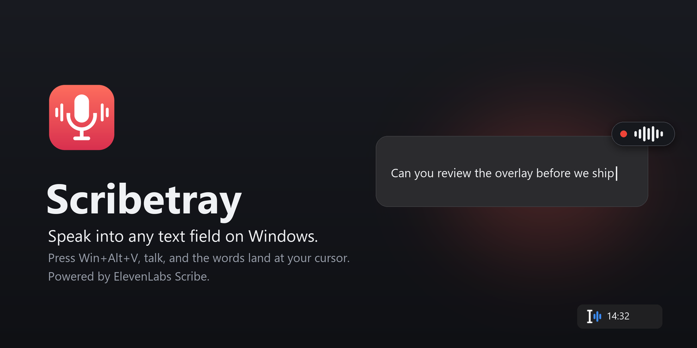
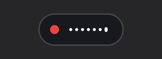
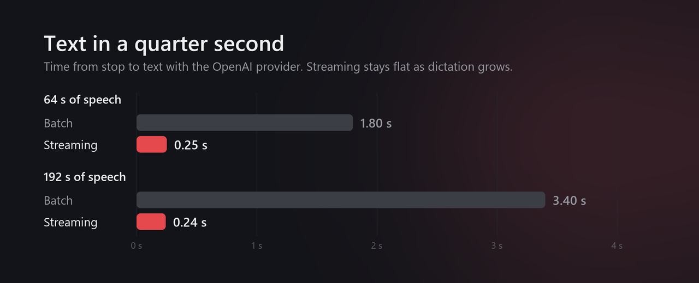
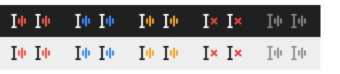

  

Scribetray is a Windows tray app for dictation with ElevenLabs Scribe or your local Codex ChatGPT login. It runs as a single executable, with no installer.

1. Put your cursor in a text field.
2. Press Win+Alt+V and speak.
3. Press Win+Alt+V again. Scribetray inserts the finished transcript when it is ready.

  

## Audio streaming

OpenAI now uploads audio while you record, so transcription starts before you stop. Scribetray inserts the finished text after you stop, with less time spent waiting.

  

If the stream fails, Scribetray makes one batch retry using the saved recording. It shortens long pauses for that upload when `trim_silence` is enabled. The original recording stays intact in local history.

ElevenLabs remains the default provider and uploads after you stop. You can enable its optional streaming mode with `realtime = true`. It also inserts only the final transcript after you stop. The `realtime` setting applies only to ElevenLabs; there is no OpenAI streaming toggle.

OpenAI support is experimental. It uses ChatGPT's private dictation endpoint and may break when OpenAI changes it.

## Get started

Download `scribetray.exe` from the [latest release](https://github.com/colthreepv/scribetray/releases/latest), put it somewhere permanent, and run it. Windows SmartScreen may warn because the executable is unsigned. Choose **More info**, then **Run anyway** if you want to proceed.

Right-click the tray icon to open the menu. The icon stays faded until Scribetray finds credentials for your selected provider.

### ElevenLabs

1. Create an API key in your [ElevenLabs account](https://elevenlabs.io/app/sign-up), under Developers, API Keys.
2. Restrict the key to Speech to Text. Add User Read permission if you want monthly credit usage in the tray menu.
3. Choose **Set API key…** in the tray menu, enter the key in `api_key = "..."`, and save the file. Keep `provider = "elevenlabs"`.

You can also set `ELEVENLABS_API_KEY`, which takes precedence over the saved key.

### OpenAI through Codex

1. Sign in to the Codex app or CLI with your ChatGPT account on this computer.
2. Choose **Open settings file…** in the tray menu and set `provider = "openai"`.
3. Save the file. The menu shows the detected account.

Scribetray reads `%CODEX_HOME%\auth.json` when `CODEX_HOME` is set, otherwise `%USERPROFILE%\.codex\auth.json`. It requires a local ChatGPT login file. API-key logins and credentials stored only in a keychain, including Windows Credential Manager, are unsupported.

Scribetray only reads that file and does not renew tokens. If the session expires, sign in again through Codex. Scribetray picks up the new login without a restart.

## Everyday use

| Default key | Action while recording |
|---|---|
| Win+Alt+V | Stop and insert the transcript. |
| Enter | Stop, insert, and press Enter to send. |
| Shift+Enter | Pass through to the app and keep recording. |
| Esc | Cancel the recording. |

Enter and the cancel shortcut are intercepted only while recording. Turn off **Intercept Enter while recording** in the menu to let Enter reach the app. Change the recording and cancel shortcuts in settings, or choose push-to-talk to record while holding the recording hotkey.

Left-click the tray icon to copy the latest transcript or retry a failed dictation. Right-click to select a microphone or language, browse history, or change settings. Dictations start with `🎙️ ` by default; turn the prefix off in the menu if you prefer.

The tray icon is coral when ready, blue while recording, amber while transcribing, and marked with a red × after an error.

  

If you switch away before the transcript is ready, Scribetray copies it to the clipboard and waits up to 20 seconds for you to return to the original field. After that, or if you start another recording, it stops waiting and leaves the text on the clipboard.

Settings live in `%APPDATA%\Scribetray\config.toml` and reload when saved. Recording changes apply to the next recording. See the [settings reference](docs/settings.md) for every option and its default.

## Privacy and costs

Audio goes to your selected provider. OpenAI and ElevenLabs streaming send audio during recording; ElevenLabs batch sends it after you stop. Cancelling cannot retract audio already transmitted. The provider's privacy and retention policies apply.

The last 20 recordings and their transcripts stay in `%LOCALAPPDATA%\Scribetray\history`. You can delete that folder to clear them. Silence trimming changes only batch uploads, not the saved audio.

The settings file stores your ElevenLabs API key in plain text. For OpenAI, Scribetray reads the local Codex access token and sends it only to ChatGPT. It does not save a separate copy or use the refresh token.

Scribetray is free. Check [ElevenLabs pricing](https://elevenlabs.io/pricing) for service costs. Scribetray cannot see your ChatGPT dictation quota.

## Compatibility and development

Scribetray supports Windows 10 and 11, with most testing on Windows 11. To insert into an app running as administrator, Scribetray must also run as administrator. Try `insert_method = "paste"` if a terminal or other app does not handle simulated typing well.

Building requires Rust 1.98+ with MSVC, CMake, NASM, and libclang. See [development instructions](docs/development.md) for setup, building, and deploying your own copy.

Licensed under the [WTFPL](LICENSE). Scribetray is independent of ElevenLabs and OpenAI.
